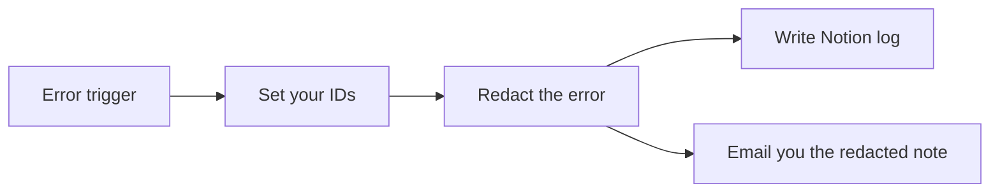

# Redacted error log

File: `workflows/06-redacted-error-log.json`  
Gate: Green (internal log)

## What it does

This is an **Error workflow**. When another workflow fails and points its Settings → Error workflow here, this one redacts common token and key patterns, truncates the text, and writes a short Notion row and/or emails you. It does not include raw execution data or request bodies on purpose.

## What it does not do

- Repair the failed workflow
- Guarantee that every possible secret is found (redaction is a safety net, not a proof)

## Diagram

## Credentials to attach

- Notion API (if you keep the Notion node)
- Email (SMTP), if you keep the email node

Create a simple Notion database with a title and a Notes (rich text) property, or disable the Notion node.

## Configuration

1. Import and save this workflow first.
2. Replace IDs.
3. In each other Agent Desk workflow you activate, set Settings → Error workflow to this one.
4. Disable Notion or Email if you only want one destination.

## After the 25 November 2026 live test

- The Redact node reads `$('Error trigger')`, not the output of Set your IDs. Leave the trigger named **Error trigger**, or edit the Code node to match the new name.
- The `writeNotion` and `notifyEmail` fields in Set your IDs are labels only. They do not disable those nodes. Turn a destination off by disabling the Notion or Email node itself.
- Redaction covers common secret and PII patterns (including `sk-` keys with hyphens, such as `sk-proj-…`, Bearer tokens, Slack `xox`, Notion `ntn_`, `secret_`, and `api_key` / password style assignments). It is a safety net, not a guarantee. Review the log before you treat it as clean. Short fragments such as `sk-test...` may not match. Stack traces and raw execution data are omitted on purpose, not stored after redaction.

## Test plan (sample data)

1. Import this workflow and attach credentials.
2. In a throwaway workflow, add a Code node that throws `new Error('test')`, set this pack file as its Error workflow, and execute it.
3. Confirm the log or email contains the test message and does not contain credentials.
4. Do not test by pasting a real live token into a node.

## Red steps

None. Do not change the Code node to log `$json` from credential-bearing nodes or full HTTP responses.
